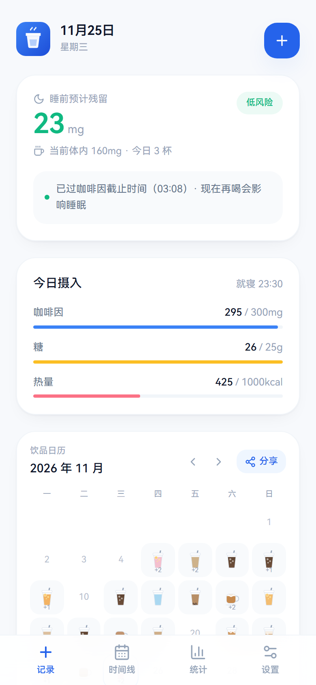
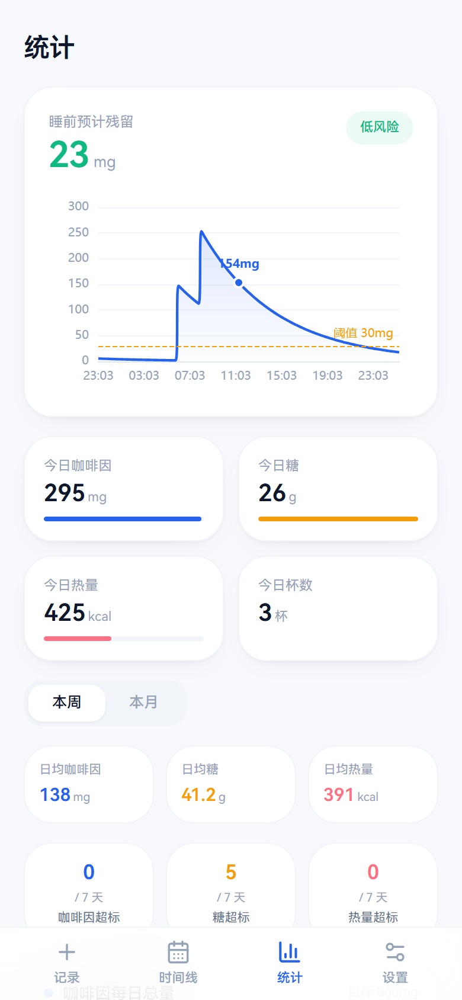
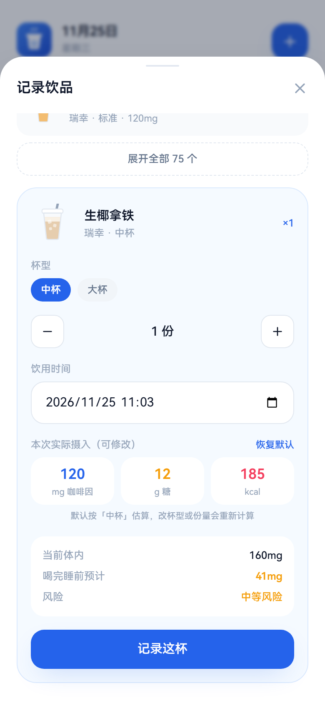
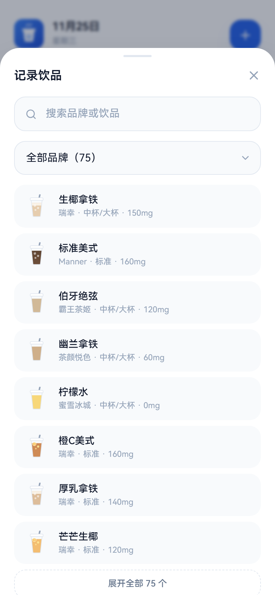
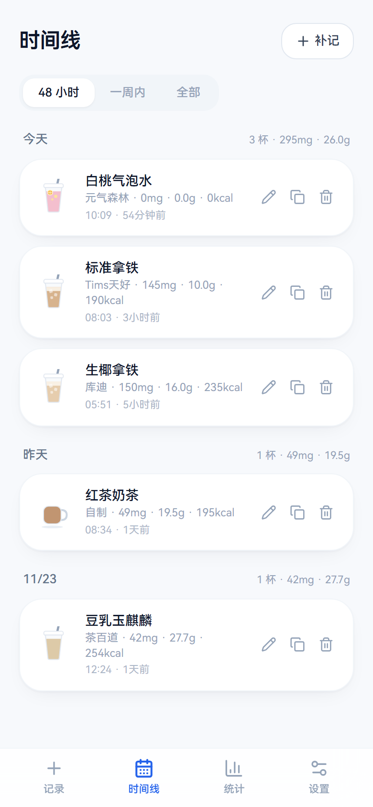
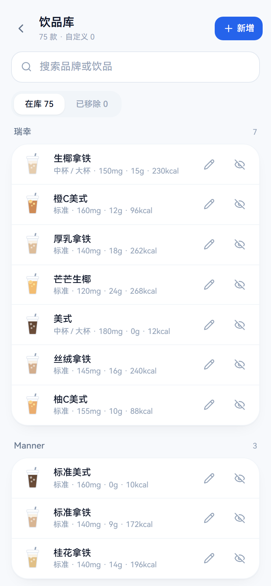
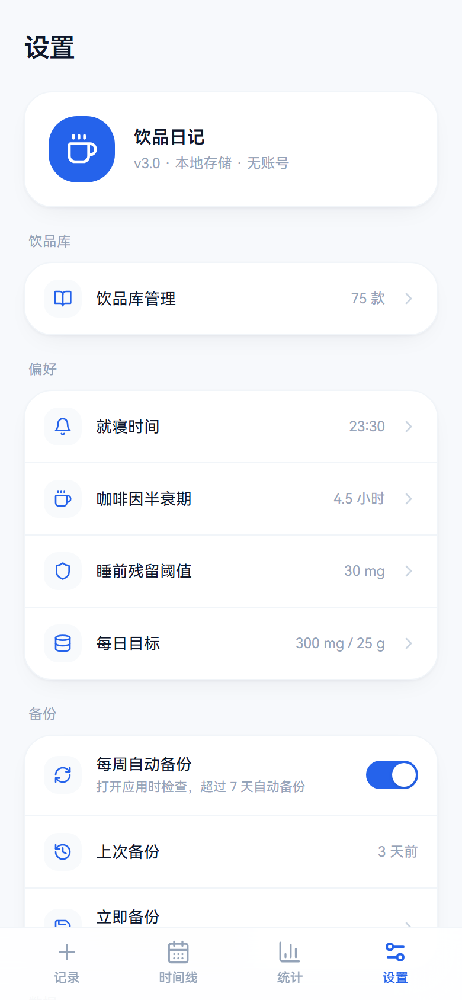
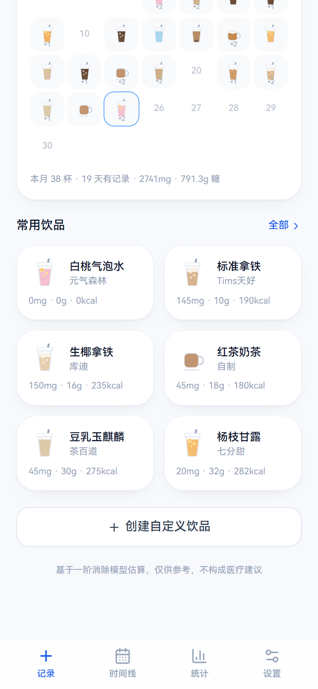

# 饮品日记

> 一杯咖啡或奶茶的**咖啡因、糖、热量**，记一笔就清楚。

手机优先的饮品记录本：记录每一杯、算出体内还剩多少咖啡因、看看今天和本月喝了什么。**数据全部留在本机**，没有账号，不需要联网。

版本 **v3.0** · 完全离线 · 零权限

<table>
  <tr>
    <td align="center"><br><sub>首页 · 睡前残留与今日摄入</sub></td>
    <td align="center"><br><sub>统计 · 咖啡因代谢曲线</sub></td>
    <td align="center"><br><sub>记录 · 杯型与投料可改</sub></td>
  </tr>
</table>

## 怎么用

一共三种装法，按你的设备挑一个：

| 用法 | 适合 | 怎么弄 |
| --- | --- | --- |
| **网页版**（推荐先试） | 任何手机、电脑 | 打开 <https://lulu3103.github.io/drink-tracker/>，浏览器菜单里「添加到主屏幕」即可当 App 用 |
| **安卓 App** | Android 6.0+ | 下载 [最新安装包](https://github.com/LuLu3103/drink-tracker/releases/latest)（约 300KB），点开安装 |
| **离线单文件** | 电脑、不爱装东西 | 用仓库里的 `打包/饮品记账本.html`，双击用浏览器打开，断网也能用 |

安装包不含任何权限，连「联网」都没申请——它只读自己肚子里的数据。

> 鸿蒙（HarmonyOS 5 及以上）不能直接装 APK：可以先用网页版「添加到桌面」，或用兼容层「卓易通」打开 APK。

## 界面

### 首页


一打开就是今天的账：

- **睡前预计残留**：按当前摄入推算到就寝时间还剩多少咖啡因，配低 / 中 / 高风险标签
- **咖啡因截止时间**：过了这个点再喝就会影响睡眠，直接告诉你「现在别喝了」
- **今日摄入**：咖啡因、糖、热量三条进度，目标可改（默认 300mg / 25g / 1000kcal）
- **饮品日历**：哪天喝了、喝了几杯一目了然，右下角一键生成分享海报
- **常用饮品**：最近喝过的 6 杯，点一下直接记录

<br clear="all">

### 记录一杯

<table>
  <tr>
    <td align="center"><br><sub>按品牌筛选，两步找到</sub></td>
    <td align="center"><br><sub>杯型、份数、实际摄入都能改</sub></td>
  </tr>
</table>

- 75 款内置饮品覆盖 29 个品牌，顶部下拉框按品牌筛，列表默认显示 8 个，可「展开全部」
- **中杯 / 大杯**切换后营养自动换算
- **本次实际摄入**可以手动改：各家配方不一样，咖啡因 / 糖 / 热量随时修正，点「恢复默认」还原
- 底部先算给你看：喝完当前体内多少、睡前预计多少、风险几档，再决定要不要喝

### 时间线与统计

<table>
  <tr>
    <td align="center"><br><sub>时间线 · 今天 / 48 小时 / 一周 / 全部</sub></td>
    <td align="center"><br><sub>统计 · 代谢曲线与周期汇总</sub></td>
  </tr>
</table>

- 时间线按天分组，每条都能**编辑、复制、删除**，右上角「补记」补昨天的
- 统计页画出过去 12 小时到就寝后 2 小时的**咖啡因代谢曲线**，标了就寝线和 30mg 阈值线
- 今日 / 本周 / 本月三档：杯数、日均咖啡因、糖、热量、超标天数

### 饮品库



按品牌分组管理，内置的也能改：

- 点铅笔改参数：咖啡因 / 糖 / 热量、杯型规格、贴图风格
- 不喝的直接「移除」，随时能从「已移除」里恢复
- 右上角「新增」建自定义饮品：选插画风格、冷热杯、杯中配料（珍珠 / 果粒 / 奶盖 / 冰块 / 气泡）、自定义主色，保存前实时预览

自带的插画按饮品形态生成，不是统一图标——美式、拿铁、奶茶、果茶、气泡水长得都不一样。

<br clear="all">

### 设置与备份

<table>
  <tr>
    <td align="center"><br><sub>设置</sub></td>
    <td align="center"><br><sub>日历与分享海报</sub></td>
  </tr>
</table>

- **偏好**：就寝时间、咖啡因半衰期、睡前残留阈值、每日目标
- **备份**：打开「每周自动备份」后，每次启动检查，超过 7 天自动存一份（只保留最新一份，旧的自动删掉）；也能立即备份、下载备份、从备份恢复
- **导出 JSON**：把全部数据存成文件，方便自己留档

## 咖啡因是怎么算的

一阶消除模型，半衰期 H 默认 4.5 小时：

```
R(t)   = Σ Dᵢ × 0.5 ^ ((t - tᵢ) / H)              体内当前残留
R_bed  = Σ Dᵢ × 0.5 ^ ((t_bed - tᵢ) / H)          睡前残留
t_cut  = t_bed - H × log₂(D / (阈值 - R_bed))      咖啡因截止时间
```

- Dᵢ 第 i 杯的咖啡因，tᵢ 喝的时间，t_bed 就寝时间
- 风险：低于阈值 = 低，阈值到 2 倍 = 中，超过 2 倍 = 高
- 糖和热量只累计，不参与代谢曲线

> 全部是估算值，不构成医疗建议。

## 数据在哪

| 用法 | 存在哪 | 什么时候会丢 |
| --- | --- | --- |
| 网页版 | 浏览器的 IndexedDB | 清浏览器数据、无痕模式 |
| 安卓 App | App 自己的 WebView 存储 | 卸载 App、清应用数据 |
| 离线单文件 | 浏览器的 localStorage | 清站点数据 |

三条路的数据**互不相通**，各存各的。所以：定期点「导出 JSON」，比什么都靠谱。

## 常见问题

**换手机了，记录能搬过去吗？**
目前只能导出 JSON 留档，还没有导入入口——换机后需要重新记录。后续版本会补上导入。

**为什么我的奶茶糖量跟 App 里不一样？**
内置数据是品牌公开信息和常见检测的估算值。请直接在记录弹窗里改「本次实际摄入」，改完不影响模板默认值。

**「现在是低风险」是不是就可以放心喝？**
风险只看咖啡因残留到睡前的量，不含糖和热量。三项指标都在首页，自己权衡。

**能装到鸿蒙手机上吗？**
不能直接装 APK。用网页版「添加到桌面」，或者装「卓易通」这类兼容层后再打开 APK。

**为什么没有联网权限？**
不需要。所有计算和存储都在本地完成，装的时候也不会向你要任何权限。

## 本地开发

```bash
npm install
npm run dev       # http://localhost:5173
npm run build     # 产物在 dist/
npm run preview
```

推送到 `main` 会自动构建并发布到 GitHub Pages（见 `.github/workflows/deploy.yml`）。`vite.config.ts` 里 `base` 是 `./`，放在子路径也能正常加载资源和 Service Worker；Cloudflare Pages / Vercel / Netlify 同样可用，构建命令 `npm run build`，输出目录 `dist`。

### 安卓 App

安装包是把离线单文件 HTML 用 WebView 封装成的原生壳：

- 页面从 APK 内的 assets 读取，用 `shouldInterceptRequest` 挂在虚拟域名 `https://appassets.androidplatform.net/` 下——这样 localStorage 有一个真实的 https origin，数据不会像 `file://` 那样容易丢
- 补齐了 WebView 缺失的能力：分享海报存到相册、导出备份存到下载目录
- 源码在 `打包/` 之外由构建脚本生成，签名密钥在 `打包/keystore/`，**升级必须用同一把密钥**，否则只能卸载重装（数据会清空）

## 技术栈

| 用途 | 选型 |
| --- | --- |
| 构建 | Vite 5 |
| 框架 | React 18 + TypeScript |
| 样式 | Tailwind CSS 3 |
| 图表 | ECharts 5（按需引入 + 独立分块） |
| 存储 | Dexie.js / IndexedDB（网页版）、localStorage（离线单文件） |
| 状态 | Zustand |
| PWA | vite-plugin-pwa / Workbox |
| 图标 | lucide-react |

## 目录

```
src/
├── components/   # 插画、弹窗、图表、Toast
├── pages/        # 记录 / 时间线 / 统计 / 设置 / 饮品库
├── db/           # 表结构 + 75 款内置饮品 + 单文件 localStorage 实现
├── store/        # 状态与咖啡因计算
├── utils/        # 格式化、ECharts 注册、海报绘制
└── types/        # 数据模型
docs/screenshots/ # 上面这些截图
打包/             # 离线单文件 HTML + 安卓安装包 + 签名密钥
```

## 许可

个人自用项目，随便看随便改。
